### 🛠️ Tech stack

<!--
### 🚀 Featured projects
| Project | Description | Stack |
|---|---|---|
| [**project-name**](https://github.com/selimayann/project-name) | One-line description | Kotlin, Spring |
-->

### 📊 GitHub stats

  

